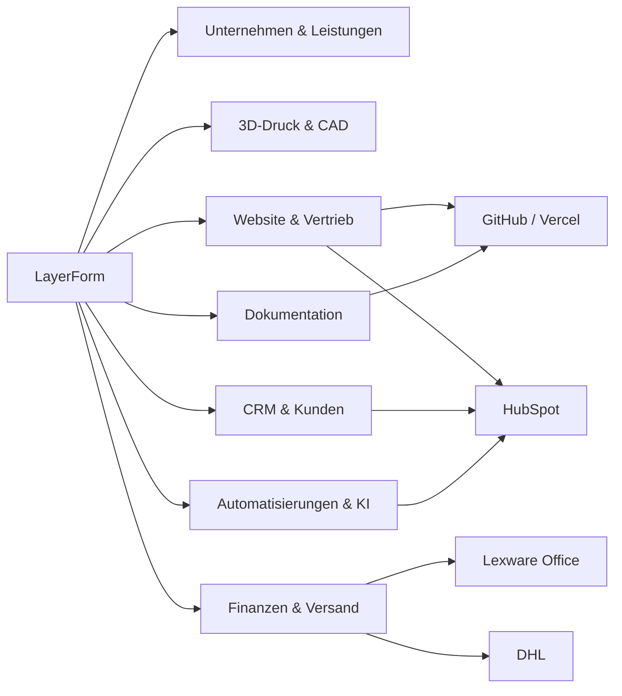

# LayerForm – zentrale Wissensbasis

> **Stand:** 2026-11-09 · **Zugriff:** Dieses Repository ist **öffentlich**. Keine personenbezogenen Auftragsdetails, Finanzkennzahlen, Secrets oder internen Sicherheitsinformationen veröffentlichen.

Diese Dateien beschreiben LayerForm übergreifend. Für operative Vorgänge ist **immer das jeweilige Live-System** maßgeblich: HubSpot für CRM, GitHub für Website-Code, Vercel für Deployments, Lexware Office für Buchhaltung und DHL für Versand. **Die GitHub-Dokumentation ist die zentrale, versionierte Wissensbasis für alle Chats.**

## Schnellnavigation

| Dokument | Zweck | Federführendes System |
| --- | --- | --- |
| [Unternehmen & Leistungen](unternehmen.md) | Firma, Kunden, Leistungen, Produktion, Strategie | Unternehmensdokumentation |
| [System- und Domain-Landkarte](systeme.md) | Plattformen, Projekte, Websites, Server, Datenhaltung | GitHub / Vercel / weitere |
| [Integrationen](integrations.md) | Bestehende technische Detaildokumentation; Website ↔ CRM, Fehlerfälle, Consent | Code + Integrationsbetreiber |
| [HubSpot & Kundenprozesse](hubspot.md) | Deal-Stufen, Felder, Lead-Prozess, offene Ansichten | HubSpot |
| [Prozesse & Automatisierungen](prozesse.md) | Angebots-, Produktions-, Rechnungs- und Versandfluss | HubSpot / Lexware / DHL |
| [Projekte & Roadmap](projekte.md) | Umgesetzte, geplante und noch zu prüfende Vorhaben | Je Projekt |
| [Regeln für alle Chats](regeln.md) | Einheitliche Lesereihenfolge, Freigaben, Sicherheit, Pflege | Alle Chats |
| [Quellen, Status & Änderungen](status.md) | Verifikationsstand, Widersprüche, Pflegeprotokoll | GitHub |
| [Übergabe aus bisherigen Chats](chat-uebergabe.md) | Entscheidungen, Schutzregeln, was bereits erledigt und was offen ist | GitHub / Fachsysteme |
| [Website & Deployment](website.md) | Codepfade, Feature-Schalter, Formulare und Prüfstrategie | GitHub / Vercel |
| [Versand & DHL](versand.md) | Label-Workflow, CRM-Felder, Sandbox-Status und Freigaben | DHL / HubSpot |
| [Marketing & Produktstrategie](marketing.md) | Kanäle, Etsy, Sortiment und Social Media | Kanaltools / GitHub |
| [Betriebsorganisation](betrieb.md) | Zuständigkeiten und sichere bereichsübergreifende Änderungen | Fachsysteme |

## Organisationslandkarte

## Integrationsgrundsätze

1. **Anfragen:** `layer-form.de` → Website-API → HubSpot-Kontakt/Deal. Wiederholungen werden im Code mit Anfrage-ID und Redis-Journal gegen Doppelerfassung geschützt; Sonderfälle und offene Live-Tests stehen in [integrations.md](integrations.md).
2. **Rechnungen:** Lexware ist die Buchhaltungsquelle. Externe Mail-/Apps-Script-Automationen dürfen nicht allein aufgrund von Vermutungen als aktiv gelten.
3. **Versand:** DHL-Tests sind keine produktive Versandfreigabe. Kostenpflichtige Labels und Kundenbenachrichtigungen verlangen sorgfältige Bestätigung.
4. **Wissen:** Jede technische Behauptung trägt eine Quelle oder wird als *noch zu prüfen* gekennzeichnet.

## Zusammenarbeit mehrerer Chats

**Bei jeder Aufgabe:** [Regeln](regeln.md) und [Chat-Übergabe](chat-uebergabe.md) lesen → relevante Fachdatei lesen → Live-System prüfen → Auswirkungen prüfen → nach nötiger Freigabe umsetzen → Ergebnis testen → passende Datei und [Status](status.md) aktualisieren. Chats sind nicht automatisch miteinander synchronisiert.

**Zentraler Einstieg:** `docs/README.md`. Ergänzungen erfolgen in den verlinkten Fachdateien, ohne parallele Wissensbasen anzulegen.
