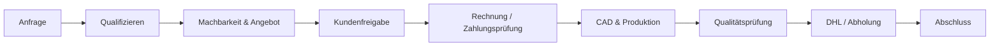

# Geschäftsprozesse und Automatisierungen

**Stand:** 2026-11-09. Die technischen Integrationsdetails und älteren, teils überholten Beschreibungen stehen in [integrations.md](integrations.md). **Abschnitt „Produktive Umstellung vom 09.11.2026“ dort hat Vorrang vor älteren Ablauf-Snapshots.**

## Auftragsfluss

Die Reihenfolge kann sich je Auftrag unterscheiden. **Niemals** Zahlung, Rechnungsversand oder Produktionsfreigabe aus einer Deal-Phase allein ableiten.

## Systemübergreifende Auslöser

| Datenfluss | Quelle | Ziel | Nachweis / Risiko |
| --- | --- | --- | --- |
| Webformular | `/api/kontakt` | HubSpot Kontakt + Deal | Code-verifiziert; Redis-Idempotenz, Anfrage-ID und Fehlerfälle siehe Integrationsdokumentation |
| Preisrechneranfrage | `/api/anfrage` | HubSpot + ggf. Files | Code-verifiziert, öffentlicher Rechner derzeit über Feature-Schalter deaktiviert |
| Kontaktbestätigung | Resend API | Kunde | Optional; erfolgreiche CRM-Erfassung bleibt davon unabhängig |
| Consent-Beleg | `/api/consent` | Upstash Redis | Code-verifiziert; Einwilligungs-UI und rechtlichen Live-Stand gesondert prüfen |
| Kundenmail-/Lead-Erkennung | Gmail/Workspace + Apps Script | HubSpot | Nur in Snapshots beschrieben; aktive Trigger und Zuordnung verifizieren |
| Rechnungsidentifikation | Lexware-E-Mail | HubSpot Deal | Geplanter/dokumentierter Flow; Fehlzuordnung vermeiden, Live-Konfiguration ungeprüft |
| Versandinformationen | HubSpot/Apps Script | DHL | Sandbox-Tests mitgeteilt; kostenpflichtige Bestellung und Produktion getrennt behandeln |
| Versandbenachrichtigung | Tracking/CRM | Kunde | Nur nach tatsächlich bestätigtem Versand und gültiger Sendungsnummer |
| Bewertungsbitte | CRM/Kommunikation | Kunde | Einwilligung, Fristen, korrekte Empfänger, vorhandene Trigger prüfen |

## Zuständigkeiten

- **GitHub / Vercel:** Frontend, Formulare, API-Code, Deployments.
- **HubSpot:** CRM-Felder, Deal-Stufen, Assoziationen und Aufgaben.
- **Lexware:** Rechnungs- und Buchhaltungsbelege.
- **DHL:** Echte Versandlabels/Tracking.
- **Google Apps Script:** Externe Trigger und Hilfsautomationen; Quellcode/Deployment separat prüfen.
- **GitHub `docs/`:** Dokumentiert Zusammenhänge, ersetzt keine Live-Konfiguration.

## Sicherheitskritische Sonderfälle

- **Unklarer Website-POST:** Nie pauschal eine blockierende Redis-Schreibmarkierung löschen; zuerst HubSpot nach Anfrage-ID prüfen und anhand Integrationsvertrag abgleichen.
- **Teilweise CRM-Erstellung:** Bereits angelegte Kontakte/Deals dürfen beim Retry nicht verdoppelt werden.
- **Rechnungs-Mails:** Eine E-Mail, ein Lexware-Beleg und ein bezahlter Auftrag sind drei verschiedene Ereignisse.
- **DHL:** Tests, Produktkatalog, Warenkorb, Label-Kauf, Sendungsnummer und tatsächliche Übergabe strikt unterscheiden.
- **Marketing:** Anfrage ist keine Zustimmung zu Werbung.

## Dienstfahrten per Handy (24.11.2026)

LIVE-VERIFIZIERT: Private Apps-Script-Web-App im bestehenden Projekt bereitgestellt: Ausführung als Inhaber, Zugriff ausschließlich „Nur ich selbst“. Das Formular schreibt direkt in das bestehende Fahrtenblatt, ohne HubSpot-Änderungen. Der private Aufruflink und die Tabellen-ID bleiben außerhalb dieses öffentlichen Repositorys.

- Datum: heute in Europe/Berlin vorbelegt, frühere Tage auswählbar, Zukunft gesperrt.
- Anlass: Poststelle, Kunde, Einkauf, sonstige.
- Poststelle: serverseitig Bargteheide und 5 km insgesamt festgelegt. Andere Fahrten benötigen Ziel und Kilometer für Hin- und Rückweg; Kunde/Auftrag optional bei Kundenfahrten.
- Ein Button „Fahrt speichern“, danach Bestätigung und „Weitere Fahrt erfassen“. Keine Notizeingabe; Zeitstempel bleibt intern.
- Anmeldung mit dem eigenen Google-Konto. Der Link lässt sich im mobilen Browser als Verknüpfung zum Startbildschirm hinzufügen. Keine Offline-Erfassung.

Quellcode: `integrations/apps-script/Fahrten_Handy.gs` und `Fahrten_Handy_UI.html`. Private Skripteigenschaft `LF_FAHRTEN_SPREADSHEET_ID` verbindet das vorhandene Sheet; `lfFahrtenHandyVerbinden` prüft diese Verbindung ausschließlich lesend. `fahrtenEinrichten` nicht erneut ausführen: Diese ältere Funktion erstellt neue Formulare/Tabellen. Vor Installation in anderen Projekten vorhandene `doGet`-Handler prüfen.

Das bestehende Add-on-Manifest benötigte für eine Bereitstellung explizite OAuth-Bereiche. Die sieben zuvor im Live-Projekt angezeigten Bereiche wurden unverändert als `oauthScopes` übernommen: script.locale, script.scriptapp, script.external_request, mail.google.com, forms, spreadsheets, userinfo.email. Kein zusätzlicher Drive-Bereich. Das übrige Manifest und bestehende Workflow-Elemente wurden beibehalten. Bei späteren Schnittstellenänderungen die explizite Liste mit dem tatsächlichen Bedarf abgleichen.

CODE-VERIFIZIERT: Inhaberprüfung, Tabellenkopfprüfung, serverseitige Eingabevalidierung, Schutz gegen Formeln und parallele/doppelte Schreibversuche. Eine unklare Speicherung bleibt gesperrt und muss vor einer neuen Eingabe manuell geprüft werden. Das private Wiederholungsjournal bleibt in Skripteigenschaften; bei wachsendem Datenvolumen dessen Speicherbelegung prüfen.

LIVE-VERIFIZIERT: Verbindung zum vorhandenen Sheet erfolgreich geprüft; veröffentlichte Oberfläche geöffnet, alle vier Anlassarten und heutiges Datum geprüft. Eine Eingabe mit 0 km wurde serverseitig abgewiesen; dadurch kein Fahrteintrag. Keine fiktive Fahrt für den Test gespeichert. Erfolgreiches Anhängen und Wiederholungsschutz isoliert gegen das tatsächliche GS-Modul getestet; ein vollständiger positiver Schreibtest in der Live-Tabelle bleibt für die nächste echte Fahrt offen.
