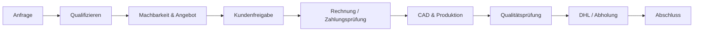

# Geschäftsprozesse und Automatisierungen

**Stand:** 2026-11-09. Die technischen Integrationsdetails und älteren, teils überholten Beschreibungen stehen in [integrations.md](integrations.md). **Abschnitt „Produktive Umstellung vom 09.11.2026“ dort hat Vorrang vor älteren Ablauf-Snapshots.**

## Auftragsfluss

Die Reihenfolge kann sich je Auftrag unterscheiden. **Niemals** Zahlung, Rechnungsversand oder Produktionsfreigabe aus einer Deal-Phase allein ableiten.

## Systemübergreifende Auslöser

| Datenfluss | Quelle | Ziel | Nachweis / Risiko |
| --- | --- | --- | --- |
| Webformular | `/api/kontakt` | HubSpot Kontakt + Deal | Code-verifiziert; Redis-Idempotenz, Anfrage-ID und Fehlerfälle siehe Integrationsdokumentation |
| Preisrechneranfrage | `/api/anfrage` | HubSpot + ggf. Files | Code-verifiziert, öffentlicher Rechner derzeit über Feature-Schalter deaktiviert |
| Kontaktbestätigung | Resend API | Kunde | Optional; erfolgreiche CRM-Erfassung bleibt davon unabhängig |
| Consent-Beleg | `/api/consent` | Upstash Redis | Code-verifiziert; Einwilligungs-UI und rechtlichen Live-Stand gesondert prüfen |
| Kundenmail-/Lead-Erkennung | Gmail/Workspace + Apps Script | HubSpot | Nur in Snapshots beschrieben; aktive Trigger und Zuordnung verifizieren |
| Rechnungsidentifikation | Lexware-E-Mail | HubSpot Deal | Geplanter/dokumentierter Flow; Fehlzuordnung vermeiden, Live-Konfiguration ungeprüft |
| Versandinformationen | HubSpot/Apps Script | DHL | Sandbox-Tests mitgeteilt; kostenpflichtige Bestellung und Produktion getrennt behandeln |
| Versandbenachrichtigung | Tracking/CRM | Kunde | Nur nach tatsächlich bestätigtem Versand und gültiger Sendungsnummer |
| Bewertungsbitte | CRM/Kommunikation | Kunde | Einwilligung, Fristen, korrekte Empfänger, vorhandene Trigger prüfen |

## Zuständigkeiten

- **GitHub / Vercel:** Frontend, Formulare, API-Code, Deployments.
- **HubSpot:** CRM-Felder, Deal-Stufen, Assoziationen und Aufgaben.
- **Lexware:** Rechnungs- und Buchhaltungsbelege.
- **DHL:** Echte Versandlabels/Tracking.
- **Google Apps Script:** Externe Trigger und Hilfsautomationen; Quellcode/Deployment separat prüfen.
- **Miro / GitHub docs:** Erklären Beziehungen, ersetzen keine Live-Konfiguration.

## Sicherheitskritische Sonderfälle

- **Unklarer Website-POST:** Nie pauschal eine blockierende Redis-Schreibmarkierung löschen; zuerst HubSpot nach Anfrage-ID prüfen und anhand Integrationsvertrag abgleichen.
- **Teilweise CRM-Erstellung:** Bereits angelegte Kontakte/Deals dürfen beim Retry nicht verdoppelt werden.
- **Rechnungs-Mails:** Eine E-Mail, ein Lexware-Beleg und ein bezahlter Auftrag sind drei verschiedene Ereignisse.
- **DHL:** Tests, Produktkatalog, Warenkorb, Label-Kauf, Sendungsnummer und tatsächliche Übergabe strikt unterscheiden.
- **Marketing:** Anfrage ist keine Zustimmung zu Werbung.
