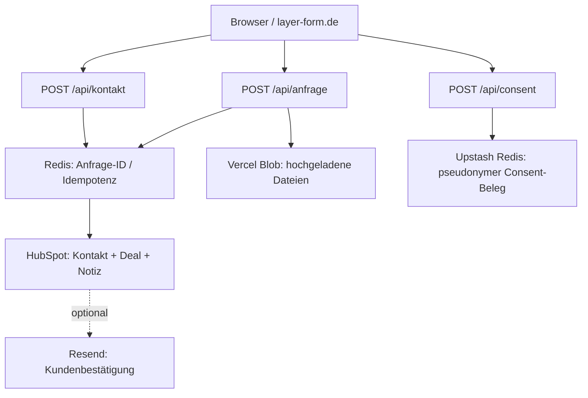

# System-, Domain- und Datenlandkarte

**Stand:** 2026-11-09. **Code-verifiziert** bedeutet im Repository vorgefunden, nicht automatisch produktiv getestet.

## Zuordnung

| System | Zweck | Fundstelle / Link | Status |
| --- | --- | --- | --- |
| GitHub `LayerInForm/LayerForm` | Quellcode der LayerForm-Website und diese Dokumentation | https://github.com/LayerInForm/LayerForm | Repository und `main` verifiziert |
| Vercel-Projekt `layerform` | Hosting/Build der Website | https://vercel.com/dashboard | Projektzuordnung aus vorhandener Integrationsdokumentation, Live-Verbindung nicht in diesem Schritt geprüft |
| `layer-form.de` / `www.layer-form.de` | Unternehmenswebsite | https://layer-form.de | Domain im Code und Dokumentation bekannt; Weiterleitungsrichtung in `integrations.md`, Live-Test offen |
| React + TypeScript + Vite | Website-Frontend | `package.json`, `vite.config.ts` | Code-verifiziert |
| Vercel Serverless API | Website-Anfrage-, Upload- und Consent-Endpunkte | `api/kontakt.ts`, `api/anfrage.ts`, `api/upload.ts`, `api/consent.ts` | Code-verifiziert |
| HubSpot | Kontakte, Firmen, Deals, Aufgaben und Lead-Zuordnung | https://app.hubspot.com/contacts/149524579/objects/0-3 | Portal aus `docs/integrations.md` |
| Upstash Redis | Wiederholungsschutz/Anfrage-Journal, Consent-Protokoll | `api/_lib/inquiries.ts`, `api/consent.ts` | Code-verifiziert; Live-Retention prüfen |
| Vercel Blob | Öffentliche Datei-Uploads des Preisrechners | `api/anfrage.ts`, `api/upload.ts` | Codepfad verifiziert; Datenschutz prüfen |
| Resend | Optionale Eingangsbestätigung | `api/kontakt.ts`, `api/anfrage.ts` | Code-verifiziert; reale Zustellung nicht getestet |
| Vercel Analytics | Optionale Website-Analytics | `package.json`, Frontend-Einbindung separat kontrollieren | Paket verifiziert; Consent prüfen |
| Google Workspace / Gmail | Geschäftliche Kommunikation | Unternehmenskontext, `integrations.md` | Mitgeteilt; externe Flows live prüfen |
| Google Apps Script / Workspace Studio | Mögliche Mail-, Rechnungs-, Versand- und CRM-Automationen | `integrations.md` | Dokumentierte Snapshots; Live-Trigger ungeprüft |
| Lexware Office | Rechnungen/Buchhaltung | https://www.lexware.de/ | Mitgeteilt; keine API-Integration bestätigt |
| DHL | Versand, Label, Tracking | https://www.dhl.de/ | Sandbox-Vorarbeiten mitgeteilt; Produktionsstatus offen |
| Ubuntu-Heimserver, Caddy, Tailscale | Private Zusatzinfrastruktur | kein öffentlicher Administrationslink | Mitgeteilt; laufende Dienste nicht vollständig verifiziert |

## Architektur: Website-Anfragen

**Wichtige Details:** Anfrage-ID, Status `writing`, Redis-Journal, Recovery bei uneindeutigen Fehlschlägen und Testumfang stehen verbindlicher in [integrations.md](integrations.md). Keine unbekannten Redis-Marker pauschal löschen.

## Website-Dateien

| Bereich | Datei |
| --- | --- |
| Hauptseite | `App.tsx`, `components/` |
| Firmendaten | `src/constants.ts` |
| Feature-Schalter | `src/features.ts` |
| Öffentlicher Preisrechner | `components/calculator/`, `src/pricing.ts`, `api/anfrage.ts` |
| Interner Bereich | `components/internal/`, `api/intern/`, `vercel.json` |
| Rechtstexte | `components/LegalPages.tsx` |
| Inhalte/Produkte | `data/` |
| Schnittstellendetails | `docs/integrations.md` |

**Aktueller Code-Schalter:** `PREISRECHNER_AKTIV = false` (`src/features.ts`); das bedeutet nicht, dass interne Kalkulatorfunktionen gelöscht sind.

## Weitere Domains und Projekte

- **TAX-Steuerberatung:** https://tax-steuern.de (*Kundenprojekt, nicht diesem GitHub-Repository zugeordnet*).
- **Buchhaltung Bohs:** https://buchhaltung-schwerin.com (*separates Kundenprojekt; Hosting/Repository offen*).
- **Partybude:** separates Vorhaben; **nicht automatisch** LayerForm-Website, -CRM oder -Repository zuordnen.

**Nicht dokumentiert, da ungeprüft:** weitere GitHub-Repositories, Vercel-Projektzuordnungen, Homeserver-Dienste/Container, vollständige DNS-Zonen, interne Hosts/Ports, tatsächliche Live-Workflow-Schalter. Vor Ergänzung im jeweiligen System lesen; keine Serverzugangsdaten veröffentlichen.
