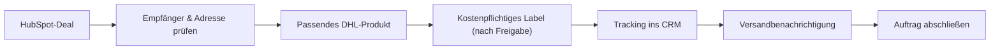

# Versand, DHL und Rechnungsübergänge

**Stand: 09.11.2026 · Quellen:** Frühere LayerForm-Workflowabsprachen und `docs/integrations.md`. **DHL-Produktivfunktionen sind nicht durch diese Dokumentation bewiesen.**

## Zielprozess

## HubSpot-Eigenschaften

| Datenart | Relevante CRM-Properties |
| --- | --- |
| Adresse | `lf_empfaenger`, `lf_strasse`, `lf_plz`, `lf_ort`, `lf_versand_adresse` |
| DHL | `lf_dhl_produkt`, `lf_dhl_link`, `lf_dhl_warenkorb_id`, `lf_dhl_warenkorb_url` |
| Kontrolle | `lf_sendungsnummer`, `lf_versand_task_id`, `lf_versandmail_am`, `lf_versanddienstleister` |
| Buchhaltung | `lf_rechnungsnummer`; in Lexware echten Beleg nachschlagen |

## Historische DHL-Sandbox-Arbeit

- DHL-Sandbox-Katalog und Warenkorb-/Checkout-Abläufe wurden in früheren Aufgaben getestet.
- Es gab dabei einen erfolgreich angenommenen Test-Warenkorb (`HTTP 201`); das beweist **keine** produktive Labelausgabe.
- Das Parsing einer Warenkorb-ID wurde früher in einem Testpfad korrigiert.
- Varianten nach Gewicht und Maßen wurden besprochen. Aktuelle DHL-Konditionen, Maße und Preise **immer live** prüfen.
- Ein DHL-Geschäftskonto bzw. die produktive Buchbarkeit war zu einem früheren Zeitpunkt noch **nicht bestätigt**.
- Hermes war zeitweilig im CRM abgebildet, die operative Priorität liegt auf **DHL**; alte Eigenschaften nicht blind löschen.

## Sicherheit und Freigaben

1. **Sandbox/Live** und **Warenkorb/gekauftes Label** unterscheiden.
2. Vor kostenpflichtiger Erstellung Empfänger, Lieferadresse, Format, Gewicht, Preis und mögliche Drittanbieter-Trigger prüfen.
3. Tracking nur übernehmen, wenn eine Sendung tatsächlich gebucht wurde und die Nummer verifiziert ist.
4. Versandbenachrichtigungen nicht mehrfach verschicken; Status `lf_versandmail_am` und vorhandene Skripte prüfen.
5. Rechnungsstellung und Zahlung sind unterschiedliche Ereignisse. Keine automatische Umstellung auf „bezahlt“ aus einer Rechnungsmail.
6. Keine echten Namen, Adressen, Sendungsnummern oder Rechnungsbeträge in diesem öffentlichen Repository veröffentlichen.
