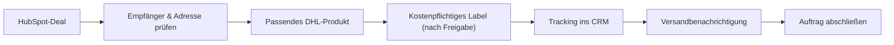

# Versand, DHL und Rechnungsübergänge

**Stand: 09.11.2026 · Quellen:** Frühere LayerForm-Workflowabsprachen und `docs/integrations.md`. **DHL-Produktivfunktionen sind nicht durch diese Dokumentation bewiesen.**

## Zielprozess

## HubSpot-Eigenschaften

| Datenart | Relevante CRM-Properties |
| --- | --- |
| Adresse | `lf_empfaenger`, `lf_strasse`, `lf_plz`, `lf_ort`, `lf_versand_adresse` |
| DHL | `lf_dhl_produkt`, `lf_dhl_link`, `lf_dhl_warenkorb_id`, `lf_dhl_warenkorb_url` |
| Kontrolle | `lf_sendungsnummer`, `lf_versand_task_id`, `lf_versandmail_am`, `lf_versanddienstleister` |
| Buchhaltung | `lf_rechnungsnummer`; in Lexware echten Beleg nachschlagen |

## Historische DHL-Sandbox-Arbeit

- DHL-Sandbox-Katalog und Warenkorb-/Checkout-Abläufe wurden in früheren Aufgaben getestet.
- Es gab dabei einen erfolgreich angenommenen Test-Warenkorb (`HTTP 201`); das beweist **keine** produktive Labelausgabe.
- Das Parsing einer Warenkorb-ID wurde früher in einem Testpfad korrigiert.
- Varianten nach Gewicht und Maßen wurden besprochen. Aktuelle DHL-Konditionen, Maße und Preise **immer live** prüfen.
- Ein DHL-Geschäftskonto bzw. die produktive Buchbarkeit war zu einem früheren Zeitpunkt noch **nicht bestätigt**.
- Hermes war zeitweilig im CRM abgebildet, die operative Priorität liegt auf **DHL**; alte Eigenschaften nicht blind löschen.

## Sicherheit und Freigaben

1. **Sandbox/Live** und **Warenkorb/gekauftes Label** unterscheiden.
2. Vor kostenpflichtiger Erstellung Empfänger, Lieferadresse, Format, Gewicht, Preis und mögliche Drittanbieter-Trigger prüfen.
3. Tracking nur übernehmen, wenn eine Sendung tatsächlich gebucht wurde und die Nummer verifiziert ist.
4. Versandbenachrichtigungen nicht mehrfach verschicken; Status `lf_versandmail_am` und vorhandene Skripte prüfen.
5. Rechnungsstellung und Zahlung sind unterschiedliche Ereignisse. Keine automatische Umstellung auf „bezahlt“ aus einer Rechnungsmail.
6. Keine echten Namen, Adressen, Sendungsnummern oder Rechnungsbeträge in diesem öffentlichen Repository veröffentlichen.

## Produktiv-Vorbereitung und Internetmarke (23.11.2026)

LIVE-VERIFIZIERT: Der bestehende DHL-Produktivschlüssel funktioniert. Katalogprüfung am 23.11.2026, 10:11 Uhr: HTTP 200, 19 Produkte; PAECKS, PAECK, PAK02, PAK05 und PAK10 vorhanden. Dabei keine Bestellung oder CRM-Änderung.

CODE-VERIFIZIERT / in Apps Script installiert und per Read-back abgeglichen: `integrations/apps-script/DHL_Produktiv_Warenkorb.gs` ergänzt einen ausschließlich manuell aufrufbaren Warenkorbpfad. `lfDhlProduktivKonfigurationPruefen` liest nur die Bereitschaft, `lfDhlProduktivVorpruefen` prüft den ausdrücklich ausgewählten Deal, `lfDhlProduktivWarenkorbErstellen` bereitet einen unbezahlten Warenkorb vor. Bestehende Helfer aus `Code.gs` und `DHL_Test.gs` bleiben erforderlich. ScriptProperties: bestehender `DHL_PROD_API_KEY` und erst nach konkreter Auftragsprüfung `LF_DHL_PROD_DEAL_ID`. Keine automatische Auswahl eines Kunden, kein Zeittrigger für die Erstellung, keine Zahlung und keine Versandmail. Die bezahlte Produktionsphase, ausdrücklicher Dienstleister DHL, vollständige Straßenadresse, unterstütztes Produkt und fehlende Sendungsnummer sind Voraussetzung. Gewicht und Außenmaße müssen zum ausgewählten Produkt passen; der Code wiegt oder vermisst die Sendung nicht.

Script-Lock und vor dem DHL-POST gesetztes Journal verhindern eine automatische zweite Warenkorberstellung nach Timeout oder unklarem Ergebnis. Erfolgreiche Antworten werden vor dem CRM-Update gesichert; ein fehlgeschlagenes CRM-Update kann ohne zweiten DHL-POST nachgetragen werden. Andere Warenkorb-IDs/Links werden nicht überschrieben. Ausschließlich HTTPS-Links auf dhl.de/www.dhl.de werden gespeichert. Kein fingierter Callback; das Bestell-Payload übernimmt den bestehenden geprüften Sandbox-Vertrag ohne dessen Platzhalter-notifyUrl. Ob für die Produktiv-App eine registrierte notifyUrl erforderlich ist, muss beim ersten konkret freigegebenen Warenkorb geprüft werden; kein Produktiv-POST wurde in dieser Aufgabe ausgeführt.

Sieben isolierte Tests prüfen den tatsächlichen neuen Quellcode mit HTTP-/CRM-Doubles: Wiederholung, CRM-Teilfehler, Timeout, fremde entryUrl, Warensendung, fehlende Voraussetzungen und schreibfreie Vorprüfung. Dies ersetzt keinen echten Label- oder Checkout-Test. Ein konkreter DHL-Auftrag und der abschließende Checkout bleiben offen.

Warensendung wird ausdrücklich vom Paketpfad ausgeschlossen. Dafür sind eine Portokasse und eine freigegebene Internetmarke-Anwendung erforderlich. Diese Zugänge wurden nicht nachgewiesen; ein normaler Online-Frankierungskauf beweist keine Portokassen-/API-Freigabe. Keine Kontoanlage, API-Freigabe oder Aufladung durchgeführt. Nächster externer Schritt: Portokasse unter https://portokasse.deutschepost.de einrichten bzw. vorhandenen Zugang verwenden; Internetmarke im DHL Developer Portal beantragen und Anwendung unter „Meine Daten → Geschäftsanwendungen“ freigeben. Zugangsdaten ausschließlich im Secret-Store, nie im Chat oder öffentlichen Repository hinterlegen.

LIVE-VERIFIZIERT (23.11.2026, 10:19 Uhr): Das neue Produktivmodul ist im bestehenden Apps-Script-Projekt installiert und gegen den Repository-Quellcode abgeglichen. `lfDhlProduktivKonfigurationPruefen` bestätigt vorhandene Versandhelfer und Produktivschlüssel; kein Auftrag ausgewählt. Kein DHL-POST oder CRM-Schreiben ausgeführt.

## Internetmarke-Modul implementiert (23.11.2026)

**CODE-VERIFIZIERT / LIVE INSTALLIERT, NOCH NICHT AKTIV:** `integrations/apps-script/Deutsche_Post_Internetmarke.gs` ist im bestehenden Apps-Script-Projekt als separate Datei gespeichert. Read-back stimmt mit dem Repository überein (11.379 Zeichen, FNV-1a 1645583287). Die lokale Konfigurationsprüfung um 10:39 Uhr Europe/Berlin bestätigt vorhandene Versandhelfer, aber unvollständige Internetmarke-Zugänge, keinen konfigurierten Auftrag und keine Kauffreigabe. Dabei keine externen API-Aufrufe, Käufe oder CRM-Änderungen. Keine neue Automatik/Trigger installiert.

Grundlage: offizielle REST-Referenz Version 1.30, am 23.11.2026 im DHL Developer Portal gelesen: https://developer.dhl.com/api-reference/deutsche-post-internetmarke-post-parcel-germany#reference-docs-section . Die Oberfläche verlinkt die Spezifikation https://developer.dhl.com/sites/default/files/2025-10/pp-post-internetmarke.yaml . SOAP ist seit Ende 2025 eingestellt und wird nicht verwendet. Internetmarke ist vom vorhandenen Paket-API-Zugang getrennt.

### Zugang und Aktivierung

1. Internetmarke-Anwendung im Developer Portal freigeben lassen; der vorhandene Paket-Key allein reicht nicht. Offizielles Antragsformular laut Anbieter: https://www.deutschepost.de/formular-ima . Produktive Portokasse verwenden; Entwickler-Portokassen liefern nur Muster und dürfen nicht für echten Versand verwendet werden.
2. Ausschließlich in den privaten Apps-Script-Skripteigenschaften `LF_POST_CLIENT_ID`, `LF_POST_CLIENT_SECRET`, `LF_POST_USERNAME`, `LF_POST_PASSWORD` hinterlegen. Keine Werte im Chat, Repository oder Ausführungsprotokoll.
3. `lfPostZugangPruefen` manuell starten. Der erste Tokenabruf kann eine Anbieter-Freigabemail auslösen; bis zur Freigabe unter Portokasse → Meine Daten → Geschäftsanwendungen ist HTTP 401 möglich. Diese Freigabe wurde hier nicht erteilt. `lfPostKonfigurationPruefen` prüft dagegen nur lokale Metadaten und löst keine Anmeldung aus.
4. Produktcode und Preis aus der aktuellen offiziellen Produkt-/Preisliste oder Products API prüfen. Mit `lfPostDruckformateLesen` verfügbare Druckformate abrufen und ein für ADDRESS_ZONE geeignetes Format mit freier erster Position bestätigen. Keine geratenen Produkt- oder Format-IDs übernehmen. Der Products-API-Abruf und eine automatische Produktauswahl sind noch nicht integriert.
5. In `LF_POST_AUFTRAG_JSON` privat genau einen geprüften Auftrag konfigurieren. Felder: `dealId` (String), `productName` exakt `WARENSENDUNG`, `productCode` (positive Ganzzahl), `priceCents` (Ganzzahl), `pageFormatId` (positive Ganzzahl), `weightGrams` (inklusive Verpackung), `dimensionsMm` (drei Außenmaße), `checkedAt` und `validUntil` als ISO-Zeitpunkte. Die Tarifprüfung gilt höchstens 24 Stunden und nie über eine bekannte Tarifänderung hinaus. Keine konkreten Kundendaten in diese Dokumentation übernehmen.
6. `lfPostVorpruefen` liest ausschließlich den ausgewählten CRM-Auftrag. Voraussetzung: Standardpipeline, bezahlte Produktionsphase, WARENSENDUNG, vorhandener Dienstleister dhl/deutsche_post und vollständige deutsche Straßenadresse. Packstation-/Sonderadressen und Gewichtszuschlag über 1.000 g werden in dieser ersten Version nicht unterstützt.
7. Erst nach konkreter Kaufentscheidung und Prüfung von Empfänger, Tarif, Druckformat und Druckbild die einmalige private Eigenschaft `LF_POST_KAUFFREIGABE` auf `<Deal-ID>:<Preis-in-Cent>` setzen. `lfPostMarkeKaufen` bucht das Porto tatsächlich ab; deshalb in dieser Aufgabe nicht ausgeführt. Keine automatische Aufladung, kein Zeittrigger.

### Verhalten und Grenzen

- Authentifizierung über POST `/user`, UTF-8 form-urlencoded, `grant_type=client_credentials`. Token und Guthaben werden nicht protokolliert.
- Kauf über POST `/app/shoppingcart/pdf?directCheckout=true&validate=false`. Ein PDF-Posten, ADDRESS_ZONE, DPI300, Druckposition 1/1/1. Dieses Druckformat muss vor Aktivierung zur tatsächlich verwendeten Seite passen.
- Script-Lock und pro Deal vor dem Kauf gespeichertes Pending-Journal verhindern parallele/automatische Zweitkäufe. Eine unklare Antwort, Timeout oder fehlende Bestätigung wird nie automatisch durch einen weiteren Kauf ersetzt. Journal ausschließlich nach manuellem Abgleich mit Portokasse/Anbieter bearbeiten.
- Erfolgsbeleg zuerst in privaten ScriptProperties sichern; CRM-Fehler lassen sich mit diesem Beleg ohne neuen Kauf nachtragen, auch nach Ablauf der Tariffreigabe. Geänderte Adressen oder andere Versandlinks führen zum Prüfstop.
- Ausschließlich den Label-Link in `lf_dhl_link` schreiben; keine Phase, Aufgabe oder Versandmail auslösen. Eine Marken-/Voucher-ID wird nicht als Paket-Sendungsnummer gespeichert. Der bestehende Mailpfad verlangt eine Sendungsnummer; das Modul setzt diese ausdrücklich nicht.
- Erste Version verlinkt das Anbieter-PDF, archiviert die Datei noch nicht dauerhaft. Linkgültigkeit und tatsächlicher Labelhost müssen beim ersten Anbieter-Test geprüft werden; nur HTTPS unter deutschepost.de/dhl.com/dhl.de ist zugelassen. Unbekannte Hosts werden nach Sicherung des Belegs gestoppt, ohne neu zu kaufen.
- Aktueller Basistarif laut https://www.deutschepost.de/de/w/warensendung.html (23.11.2026): 2,70 EUR bis 1.000 g, 100–353 × 70–250 × maximal 50 mm. Code begrenzt auf dieses Basisformat; kein fest eingebauter Preis/Produktcode. Auf dem fertigen Versandstück muss über der Anschrift „Warensendung“ stehen; beim ersten Druckbild prüfen bzw. ergänzen.

Elf isolierte Tests am tatsächlichen Modul prüfen Kaufvertrag, UTF-8/Form-Encoding, Einmalfreigabe, Wiederholung, abgelaufene Tarife, zulässige Mindestmaße, falsche/fehlende Daten, leere Portokasse, Authentifizierungsfehler, Timeout, fremden Labelhost, Adressänderung und CRM-Teilfehler. Insgesamt 43 Repository-Tests erfolgreich. Dies belegt keine echte API-Anmeldung, Portokassenfreigabe, Zahlung oder gültige Versandmarke. Genau diese Anbieterprüfung bleibt wegen fehlender separater Zugangsdaten offen.
