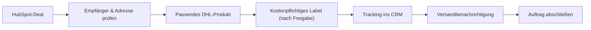

# Versand, DHL und Rechnungsübergänge

**Stand: 09.11.2026 · Quellen:** Frühere LayerForm-Workflowabsprachen und `docs/integrations.md`. **DHL-Produktivfunktionen sind nicht durch diese Dokumentation bewiesen.**

## Zielprozess

## HubSpot-Eigenschaften

| Datenart | Relevante CRM-Properties |
| --- | --- |
| Adresse | `lf_empfaenger`, `lf_strasse`, `lf_plz`, `lf_ort`, `lf_versand_adresse` |
| DHL | `lf_dhl_produkt`, `lf_dhl_link`, `lf_dhl_warenkorb_id`, `lf_dhl_warenkorb_url` |
| Kontrolle | `lf_sendungsnummer`, `lf_versand_task_id`, `lf_versandmail_am`, `lf_versanddienstleister` |
| Buchhaltung | `lf_rechnungsnummer`; in Lexware echten Beleg nachschlagen |

## Historische DHL-Sandbox-Arbeit

- DHL-Sandbox-Katalog und Warenkorb-/Checkout-Abläufe wurden in früheren Aufgaben getestet.
- Es gab dabei einen erfolgreich angenommenen Test-Warenkorb (`HTTP 201`); das beweist **keine** produktive Labelausgabe.
- Das Parsing einer Warenkorb-ID wurde früher in einem Testpfad korrigiert.
- Varianten nach Gewicht und Maßen wurden besprochen. Aktuelle DHL-Konditionen, Maße und Preise **immer live** prüfen.
- Ein DHL-Geschäftskonto bzw. die produktive Buchbarkeit war zu einem früheren Zeitpunkt noch **nicht bestätigt**.
- Hermes war zeitweilig im CRM abgebildet, die operative Priorität liegt auf **DHL**; alte Eigenschaften nicht blind löschen.

## Sicherheit und Freigaben

1. **Sandbox/Live** und **Warenkorb/gekauftes Label** unterscheiden.
2. Vor kostenpflichtiger Erstellung Empfänger, Lieferadresse, Format, Gewicht, Preis und mögliche Drittanbieter-Trigger prüfen.
3. Tracking nur übernehmen, wenn eine Sendung tatsächlich gebucht wurde und die Nummer verifiziert ist.
4. Versandbenachrichtigungen nicht mehrfach verschicken; Status `lf_versandmail_am` und vorhandene Skripte prüfen.
5. Rechnungsstellung und Zahlung sind unterschiedliche Ereignisse. Keine automatische Umstellung auf „bezahlt“ aus einer Rechnungsmail.
6. Keine echten Namen, Adressen, Sendungsnummern oder Rechnungsbeträge in diesem öffentlichen Repository veröffentlichen.

## Produktiv-Vorbereitung und Internetmarke (23.11.2026)

LIVE-VERIFIZIERT: Der bestehende DHL-Produktivschlüssel funktioniert. Katalogprüfung am 23.11.2026, 10:11 Uhr: HTTP 200, 19 Produkte; PAECKS, PAECK, PAK02, PAK05 und PAK10 vorhanden. Dabei keine Bestellung oder CRM-Änderung.

CODE-VERIFIZIERT / in Apps Script installiert und per Read-back abgeglichen: `integrations/apps-script/DHL_Produktiv_Warenkorb.gs` ergänzt einen ausschließlich manuell aufrufbaren Warenkorbpfad. `lfDhlProduktivKonfigurationPruefen` liest nur die Bereitschaft, `lfDhlProduktivVorpruefen` prüft den ausdrücklich ausgewählten Deal, `lfDhlProduktivWarenkorbErstellen` bereitet einen unbezahlten Warenkorb vor. Bestehende Helfer aus `Code.gs` und `DHL_Test.gs` bleiben erforderlich. ScriptProperties: bestehender `DHL_PROD_API_KEY` und erst nach konkreter Auftragsprüfung `LF_DHL_PROD_DEAL_ID`. Keine automatische Auswahl eines Kunden, kein Zeittrigger für die Erstellung, keine Zahlung und keine Versandmail. Die bezahlte Produktionsphase, ausdrücklicher Dienstleister DHL, vollständige Straßenadresse, unterstütztes Produkt und fehlende Sendungsnummer sind Voraussetzung. Gewicht und Außenmaße müssen zum ausgewählten Produkt passen; der Code wiegt oder vermisst die Sendung nicht.

Script-Lock und vor dem DHL-POST gesetztes Journal verhindern eine automatische zweite Warenkorberstellung nach Timeout oder unklarem Ergebnis. Erfolgreiche Antworten werden vor dem CRM-Update gesichert; ein fehlgeschlagenes CRM-Update kann ohne zweiten DHL-POST nachgetragen werden. Andere Warenkorb-IDs/Links werden nicht überschrieben. Ausschließlich HTTPS-Links auf dhl.de/www.dhl.de werden gespeichert. Kein fingierter Callback; das Bestell-Payload übernimmt den bestehenden geprüften Sandbox-Vertrag ohne dessen Platzhalter-notifyUrl. Ob für die Produktiv-App eine registrierte notifyUrl erforderlich ist, muss beim ersten konkret freigegebenen Warenkorb geprüft werden; kein Produktiv-POST wurde in dieser Aufgabe ausgeführt.

Sieben isolierte Tests prüfen den tatsächlichen neuen Quellcode mit HTTP-/CRM-Doubles: Wiederholung, CRM-Teilfehler, Timeout, fremde entryUrl, Warensendung, fehlende Voraussetzungen und schreibfreie Vorprüfung. Dies ersetzt keinen echten Label- oder Checkout-Test. Ein konkreter DHL-Auftrag und der abschließende Checkout bleiben offen.

Warensendung wird ausdrücklich vom Paketpfad ausgeschlossen. Dafür sind eine Portokasse und eine freigegebene Internetmarke-Anwendung erforderlich. Diese Zugänge wurden nicht nachgewiesen; ein normaler Online-Frankierungskauf beweist keine Portokassen-/API-Freigabe. Keine Kontoanlage, API-Freigabe oder Aufladung durchgeführt. Nächster externer Schritt: Portokasse unter https://portokasse.deutschepost.de einrichten bzw. vorhandenen Zugang verwenden; Internetmarke im DHL Developer Portal beantragen und Anwendung unter „Meine Daten → Geschäftsanwendungen“ freigeben. Zugangsdaten ausschließlich im Secret-Store, nie im Chat oder öffentlichen Repository hinterlegen.

LIVE-VERIFIZIERT (23.11.2026, 10:19 Uhr): Das neue Produktivmodul ist im bestehenden Apps-Script-Projekt installiert und gegen den Repository-Quellcode abgeglichen. `lfDhlProduktivKonfigurationPruefen` bestätigt vorhandene Versandhelfer und Produktivschlüssel; kein Auftrag ausgewählt. Kein DHL-POST oder CRM-Schreiben ausgeführt.
